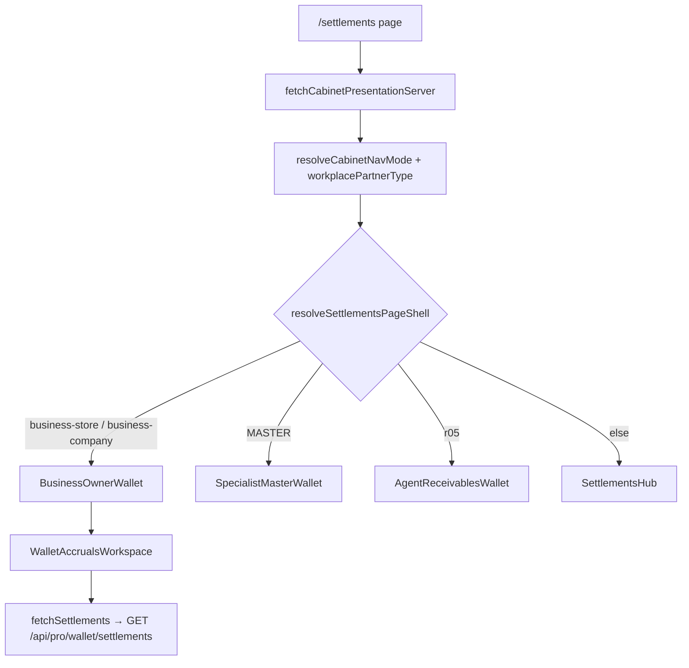

# R1 Wave 2 — Wallet / settlements frontend audit (read-only)

**Audience:** permissions approval, QA handoff, navigator backend audit `bc-ab35b8c5`  
**Authoring:** frontend read-only audit only — no product/runtime changes in this delivery  
**QA / source SHA (immutable):** `edb2c187e8102d27afdbdd47a4001b1ee19f5b60`  
**Remote baseline branch:** `release/partner-mobile-metrics-img7977-runtime-20261110`  
**Docs branch (this file):** `docs/r1-wave2-wallet-frontend-audit-20261110`  
**Parallel backend:** navigator repo, cloud agent `bc-ab35b8c5` (`authorizeSettlementWalletRead`, `/api/pro/wallet/settlements`, `/api/pro/context` DTO)

## Product ask (clarified 2026-11-10)

**Persona (scoped, not generic staff):** Sergey Zhukov — **руководитель** in the optovik (COMPANY) LK, **not** `ORG_OWNER`. Product position label (`membershipPosition`, e.g. «Руководитель отдела…») is **display only**; the frontend **does not** treat “руководитель” as a role or auto-expand wallet read.

**Approved permission change (configuration only):** grant **`canViewWallet`** (Prof-I `ledger`) on **every org branch** where full org partner-ledger read is intended — **grant-only**. No payout flags, no new org roles, no owner/admin grants, no blanket “all employees.”

**Desired UX:** in **ЛК → Кошелёк**, **owner-style partner transaction view** aggregated across **all branches of that organization** that appear in the member’s ACTIVE assignments with `canViewWallet` — read-only (no payout write, no requisites manage).

**This audit / R1 wave constraints:**

- **No backend source changes** in scope — verify behavior on **sandbox login**; org/account/grants checked via **owner UI** (Comet unavailable).
- **No unnecessary partner `src/` changes** — frontend gaps listed below are **minimal**; implement only if sandbox proves a UI leak.
- Fixtures only in tests (`fixtureSergeyOrgEmployeeContext`); no hardcoded production account id/email/name.
- Symbol `wallet_READ_FINANCE` **does not exist** — read = **`canViewWallet`** in `branchAssignments[].effectivePermissions` (or `activeBranch` fallback).

## Entry surfaces (live `edb2c187`)

| Surface | Path | Role for wholesale employee |
|--------|------|-----------------------------|
| **Кошелёк (primary)** | `src/app/settlements/page.tsx` | Business shell when `navMode` is `business-company` / `business-store` |
| **History hub** | `src/app/(cabinet)/history/page.tsx` → `HistoryHub` | Agent/specialist purchase & accrual history; **not** the org wholesale partner-ledger shell |
| **Legacy hub** | `SettlementsHub` | Used when `resolveSettlementsPageShell` returns `hub` (not org workplace path) |

### Routing / shell



- `resolveSettlementsPageShell` (`src/lib/settlements-page-shell.ts`) maps org workplace nav to **`master-wallet` shell label**, but the **component** for business is `BusinessOwnerWallet`, not specialist wallet.
- Org staff need `workplacePartnerType` from **org context** (`resolveWorkplacePartnerTypeResolution` in `src/lib/cabinet-presentation/resolve.ts`). If context is invalid or partner type missing, `employeeRequiresWorkplaceContext` fails closed (cabinet gating elsewhere).

## Read gate chain (frontend)

### 1. Page-level auth mirror

`src/app/settlements/page.tsx`:

- `resolveSettlementWalletReadAccess` → `authorizeSettlementWalletRead` (`src/lib/business-wallet/access.ts`).
- On deny: `settlementsAccessBlockedMessage` → `BusinessOwnerWallet` → `WalletAccrualsWorkspace` `accessBlockedMessage` ( **no** `fetchSettlements`, no fake empty ledger).

### 2. `authorizeSettlementWalletRead` (navigator mirror)

File: `src/lib/employee-workspace-data/settlement-wallet-read-auth.ts`

| Mode | Who | Condition |
|------|-----|-----------|
| `pro-owner` | `ORG_OWNER` + valid context | Full owner ledger |
| `org-member-with-ledger` | `ORG_EMPLOYEE` / `ORG_TEAM_MEMBER` / `BRANCH_MANAGER` / `BRANCH_EMPLOYEE` (not owner) | ACTIVE grants + `canViewWallet` on **≥1** branch; `branchIds` = **union** of all grants with flag |
| `pro-solo` | `user.role === PRO` non-org path | Legacy PRO gate |
| deny | CLIENT without org grants | `raw_pro_gate`, `no_active_branch_grant`, `missing_wallet_permission`, … |

Payout is **explicitly separate**: `authorizeSettlementWalletPaymentMutations` requires `canPayBonusCash` | `canPayBonusTransfer` — **not** implied by read (Sergey scenario: wallet **true**, payout **false**).

### 3. Branch grants filter (critical DTO contract)

File: `src/lib/employee-workspace-data/branch-assignment-auth.ts`

- `activeBranchPermissionGrants` keeps only `branchAssignments[]` where **`status === "ACTIVE"`**.
- If the list is empty, fallback is **only** `activeBranch` + `effectivePermissions` (single branch).
- **Manager “all branches” on frontend:** `branchIdsWithPermission(grants, "canViewWallet")` collects **every** ACTIVE assignment with the flag — not limited to `activeBranch` when the full `branchAssignments[]` list is present.
- **Fallback risk (QA, not code):** if context only has `activeBranch` + `effectivePermissions` (no per-branch rows), auth `branchIds` is **one** branch even when owner UI granted wallet on all branches — ledger breadth then depends on **runtime context DTO**, outside this doc’s backend-edit scope.
- **`ORG_EMPLOYEE` / manager with N branches and no `activeBranch`:** rows missing `status: "ACTIVE"` → **zero grants** → blocked UI before fetch.

**DTO contract (verify on sandbox, no source change in this wave):** each granted branch must appear as `branchAssignments[]` with `status: "ACTIVE"` and `effectivePermissions.canViewWallet: true`.

### 4. Write / owner-only UI (already partially separated)

| Capability | Frontend gate | Staff expectation |
|------------|---------------|-------------------|
| Ledger read | `authorizeSettlementWalletRead` | Allow with `canViewWallet` |
| Manage requisites | `canManageBusinessWalletRequisites` — `user.role === PRO` && `ORG_OWNER` only | `BusinessOwnerWallet` `canManageRequisites={false}` → blocked tab copy (tested) |
| Payout buttons | **API** `row.payoutActions` in `WalletAccrualsShell` / `SettlementsHub` | Must be absent or false from **navigator** for staff; frontend does **not** call `authorizeSettlementWalletPaymentMutations` before rendering payout UI on business wallet path |
| Onboarding history link | `canLinkOnboardingHistoryFromUserRole` | PROP chain tested; unrelated to partner ledger rows |

**Gap (defense in depth, post-approval only):** business wallet path trusts server `payoutActions`. Agent incoming-only view strips payout in `settlements-display.ts`; **no equivalent strip** for `org-member-with-ledger` mode today.

## Data / API (frontend expectations — backend must enforce)

| Call | Client | Scoping note |
|------|--------|----------------|
| `GET /api/pro/context` | `fetchCabinetPresentationServer` | Must return role, organization, `branchAssignments` (ACTIVE), permissions flags |
| `GET /api/pro/wallet/settlements` | `src/lib/settlements-loader.ts` (no query params) | **All** branch filtering and owner-ledger projection must be **server-side** using same rules as `authorizeSettlementWalletRead` + `branchIds` |

Frontend does **not** pass `branchId` or page-computed `walletReadAuth.branchIds` to `fetchSettlements` — the settlements page only uses auth for **allow/deny** (`settlements/page.tsx`). Multi-branch **row content** is therefore **not filtered in partner `src/`**; sandbox must show the correct ledger for the configured grants.

**Parallel navigator read-only audit** (`bc-ab35b8c5`) remains the place for API settlement scoping proofs; **this wave does not authorize navigator patches.**

## Manager + all-branch: frontend gap assessment (`edb2c187`)

| Check | Result |
|-------|--------|
| Owner-only read gate? | **No** — org staff use `org-member-with-ledger`, not `pro-owner`. |
| Title «руководитель» required? | **No** — only `canViewWallet` on grants. |
| All branches when each grant has wallet? | **Auth union OK**; no client-side branch filter on ledger fetch. |
| Payout UI without payout grants? | **Possible gap** — UI follows API `payoutActions` (see below). |
| Requisites / payout mutations | Already owner-PRO-only (`canManageBusinessWalletRequisites`). |

**Minimal partner code (only if sandbox proves need):** strip/hide `payoutActions` on business wallet when `authorizeSettlementWalletPaymentMutations` denies — optional one mapper/shell guard; **not** required for read visibility itself.

**Not recommended:** new role types, client-side branch query params, HistoryHub changes, or broadening `authorizeSettlementWalletRead` beyond existing grant mirror.

## What blocks the manager persona today (checklist)

1. **Context DTO:** missing `status: "ACTIVE"` on `branchAssignments` → frontend deny before any fetch.
2. **Missing `canViewWallet` on any ACTIVE grant** → `missing_wallet_permission` (correct fail-closed).
3. **`contextReady` false / invalid snapshot** → blocked message (fail-closed).
4. **Backend settlements 403 or empty** while frontend allows → UX empty/error (not a frontend logic bug); fix on navigator.
5. **Payout leakage:** if API returns `payoutActions: { canRecordCash: true }` for staff, UI **will** show payout (frontend gap).
6. **Workplace context:** org staff without `workplacePartnerType` from org context may not reach business wallet shell (`employeeRequiresWorkplaceContext`).
7. **HistoryHub confusion:** users may open **История** expecting partner ledger; that route loads `fetchHistoryData` (purchases/accruals), not org wallet settlements — product/doc clarity only, not a permission fix.

No production `accountId` was used or invented in this audit.

## Sandbox QA (grant-only, owner UI)

1. **Owner UI:** assign **only** `canViewWallet` / «Просмотр расчётов» on **each** org branch for the manager member (not all staff).
2. **Sandbox login** as manager (Comet unavailable) → `/settlements` → business `BusinessOwnerWallet`.
3. **Context check:** `/api/pro/context` (network tab) shows **N** `branchAssignments` ACTIVE rows with `canViewWallet: true` (not single-branch fallback only).
4. **Ledger check:** partner rows match owner-style **across org branches** subject to runtime settlements API (empty/403 = runtime/config, not a signal to patch partner read gate without evidence).
5. **Negative:** staff **without** wallet grant must still see blocked copy and **no** settlements fetch (`WalletAccrualsWorkspace.access-blocked.test.tsx` behavior).

## Proposed change scope (minimal)

**Default for this clarification: no partner `src/` commit required.**

| If sandbox shows… | Action |
|-------------------|--------|
| Blocked ledger despite grants on all branches | Fix **context DTO** / settlements auth on runtime stack (outside frontend source edit scope here). |
| Ledger OK, payout buttons visible | Smallest partner diff: gate `payoutActions` with `authorizeSettlementWalletPaymentMutations` |
| Ledger OK, no payout UI | **No product code** |
| Optional hardening | One unit test: multi-branch `branchIds` union in `settlement-wallet-read-auth.test.ts` (docs/QA only unless requested) |

### Explicit non-goals (unchanged)

- Redesign / R2 / new features.
- Owner-only interpretation or **blanket** wallet for all org employees.
- Navigator/backend source patches in this wave.
- Hardcoding Sergey email/name/id.
- Fake production success in client when API denies.

## Existing tests (run on `edb2c187`, short matrix)

```bash
# From repo root at edb2c187 (after pnpm install)
pnpm run test:component -- src/lib/employee-workspace-data/settlement-wallet-read-auth.test.ts \
  src/components/wallet-accruals/WalletAccrualsWorkspace.access-blocked.test.tsx \
  src/components/business-wallet/BusinessOwnerWallet.history-prop.test.tsx
```

**2026-11-10 run on `edb2c187`:** 8 tests passed in those three files (vitest may still execute other suites via project config — do not treat unrelated failures as wallet-audit signal).

Optional if touching display mappers: `src/lib/wallet-accruals/settlements-display.test.ts` (incoming-only strip pattern).

Production build: only if implementation PR touches `src/`; not required for this docs-only commit.

## Release drift note (workspace vs live)

At conversation time, local workspace HEAD on another branch had **removed** `src/lib/employee-workspace-data/*` and `business-wallet/access` wiring compared to live `edb2c187`. **R1 wallet read gates exist on live baseline** above; verify partner release branch contains those paths before QA.

## Handoff verification commands

```bash
git fetch origin release/partner-mobile-metrics-img7977-runtime-20261110
git rev-parse edb2c187e8102d27afdbdd47a4001b1ee19f5b60
# expect: edb2c187e8102d27afdbdd47a4001b1ee19f5b60

git ls-tree -r edb2c187 --name-only | grep -E 'settlement-wallet-read-auth|business-wallet/access'
```

Expected paths on live:

- `src/lib/employee-workspace-data/settlement-wallet-read-auth.ts`
- `src/lib/employee-workspace-data/branch-assignment-auth.ts`
- `src/lib/business-wallet/access.ts`
- `src/app/settlements/page.tsx`

## Blockers / verification (no backend source in this wave)

| ID | What to verify | Typical owner |
|----|----------------|---------------|
| V1 | Owner UI: `canViewWallet` on **all** intended branches for **this manager only** | Owner / ops via UI |
| V2 | Sandbox context: full ACTIVE `branchAssignments` list matches grants | QA + network |
| V3 | Sandbox settlements: owner-style partner ledger visible across org branches | QA (runtime API) |
| V4 | No payout / requisites actions for manager | QA UI + optional partner strip if API leaks |
| V5 | Partner release `edb2c187` includes wallet read mirror modules | Release manager |
| V6 | Staff without wallet grant remain blocked | QA negative |

Prior code blockers B1–B4 are **runtime verification** items unless a separate navigator release is explicitly opened later.

## Coordination

- **Backend auditor:** navigator `bc-ab35b8c5` — API + `authorizeSettlementWalletRead` parity, settlements scoping.
- **This doc:** partner platform frontend gates and UI trust boundaries only.
- **Client baseline** (separate repo): `e7aba0e0` / `release/client-r1-catalog-auth-integration-20261110` — not audited here.

---

*Document-only artifact; runtime candidate excludes QA stands and this file unless explicitly bundled in a docs release.*
