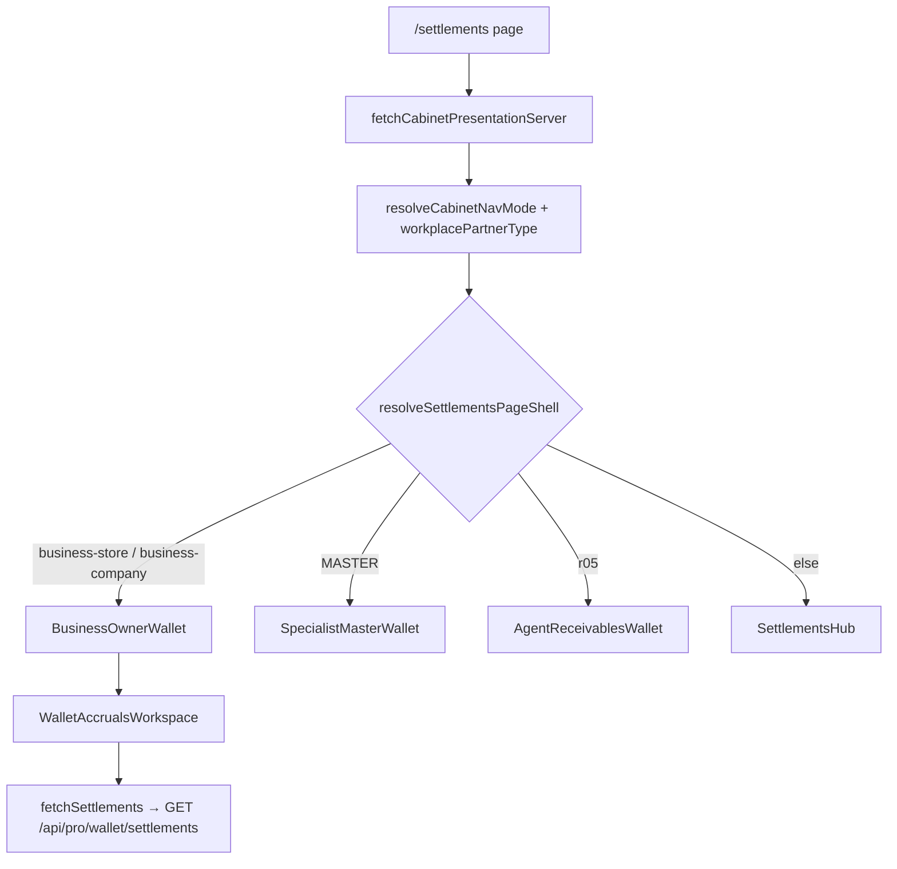

# R1 Wave 2 — Wallet / settlements frontend audit (read-only)

**Audience:** permissions approval, QA handoff, navigator backend audit `bc-ab35b8c5`  
**Authoring:** frontend read-only audit only — no product/runtime changes in this delivery  
**QA / source SHA (immutable):** `edb2c187e8102d27afdbdd47a4001b1ee19f5b60`  
**Remote baseline branch:** `release/partner-mobile-metrics-img7977-runtime-20261110`  
**Docs branch (this file):** `docs/r1-wave2-wallet-frontend-audit-20261110`  
**Parallel backend:** navigator repo, cloud agent `bc-ab35b8c5` (`authorizeSettlementWalletRead`, `/api/pro/wallet/settlements`, `/api/pro/context` DTO)

## Product ask (approved direction pending)

Сергей Жуков (сотрудник ЛК оптовика, роль org staff, **не** владелец) должен в **ЛК → Кошелёк** видеть **транзакции по партнёрам в том же read-смысле, что владелец**, без payout/owner/admin/write и без расширения grants.

Constraints for any future implementation:

- Read visibility only; hide or server-disable payout, реквизиты management, admin surfaces.
- Preserve **org** and **branch** isolation (`branchIds` from grants with `canViewWallet`).
- No real OTP/logins, no production ledger reads in this audit; fixtures only (`fixtureSergeyOrgEmployeeContext`).
- Symbol `wallet_READ_FINANCE` **does not exist** in this repo — wallet read maps to Prof-I **`ledger` → `canViewWallet`** in `src/lib/prof-i-permissions.ts`.

## Entry surfaces (live `edb2c187`)

| Surface | Path | Role for wholesale employee |
|--------|------|-----------------------------|
| **Кошелёк (primary)** | `src/app/settlements/page.tsx` | Business shell when `navMode` is `business-company` / `business-store` |
| **History hub** | `src/app/(cabinet)/history/page.tsx` → `HistoryHub` | Agent/specialist purchase & accrual history; **not** the org wholesale partner-ledger shell |
| **Legacy hub** | `SettlementsHub` | Used when `resolveSettlementsPageShell` returns `hub` (not org workplace path) |

### Routing / shell



- `resolveSettlementsPageShell` (`src/lib/settlements-page-shell.ts`) maps org workplace nav to **`master-wallet` shell label**, but the **component** for business is `BusinessOwnerWallet`, not specialist wallet.
- Org staff need `workplacePartnerType` from **org context** (`resolveWorkplacePartnerTypeResolution` in `src/lib/cabinet-presentation/resolve.ts`). If context is invalid or partner type missing, `employeeRequiresWorkplaceContext` fails closed (cabinet gating elsewhere).

## Read gate chain (frontend)

### 1. Page-level auth mirror

`src/app/settlements/page.tsx`:

- `resolveSettlementWalletReadAccess` → `authorizeSettlementWalletRead` (`src/lib/business-wallet/access.ts`).
- On deny: `settlementsAccessBlockedMessage` → `BusinessOwnerWallet` → `WalletAccrualsWorkspace` `accessBlockedMessage` ( **no** `fetchSettlements`, no fake empty ledger).

### 2. `authorizeSettlementWalletRead` (navigator mirror)

File: `src/lib/employee-workspace-data/settlement-wallet-read-auth.ts`

| Mode | Who | Condition |
|------|-----|-----------|
| `pro-owner` | `ORG_OWNER` + valid context | Full owner ledger |
| `org-member-with-ledger` | `ORG_EMPLOYEE` / `BRANCH_*` / etc. | ACTIVE grants + `canViewWallet` on ≥1 branch + `organization.ownerId` |
| `pro-solo` | `user.role === PRO` non-org path | Legacy PRO gate |
| deny | CLIENT without org grants | `raw_pro_gate`, `no_active_branch_grant`, `missing_wallet_permission`, … |

Payout is **explicitly separate**: `authorizeSettlementWalletPaymentMutations` requires `canPayBonusCash` | `canPayBonusTransfer` — **not** implied by read (Sergey scenario: wallet **true**, payout **false**).

### 3. Branch grants filter (critical DTO contract)

File: `src/lib/employee-workspace-data/branch-assignment-auth.ts`

- `activeBranchPermissionGrants` keeps only `branchAssignments[]` where **`status === "ACTIVE"`**.
- If the list is empty, fallback is **only** `activeBranch` + `effectivePermissions` (single branch).
- **`ORG_EMPLOYEE` with six branches and no `activeBranch`:** all rows missing `status` → **zero grants** → `no_active_branch_grant` even if permissions exist elsewhere in the payload.

**Backend prerequisite (navigator, not necessarily on partner live stack yet):** serializer emitting `branchAssignments[].status: "ACTIVE"` (private chain tip `960ba411` referenced in R1 coordination). Frontend at `edb2c187` **already depends** on this shape.

### 4. Write / owner-only UI (already partially separated)

| Capability | Frontend gate | Staff expectation |
|------------|---------------|-------------------|
| Ledger read | `authorizeSettlementWalletRead` | Allow with `canViewWallet` |
| Manage requisites | `canManageBusinessWalletRequisites` — `user.role === PRO` && `ORG_OWNER` only | `BusinessOwnerWallet` `canManageRequisites={false}` → blocked tab copy (tested) |
| Payout buttons | **API** `row.payoutActions` in `WalletAccrualsShell` / `SettlementsHub` | Must be absent or false from **navigator** for staff; frontend does **not** call `authorizeSettlementWalletPaymentMutations` before rendering payout UI on business wallet path |
| Onboarding history link | `canLinkOnboardingHistoryFromUserRole` | PROP chain tested; unrelated to partner ledger rows |

**Gap (defense in depth, post-approval only):** business wallet path trusts server `payoutActions`. Agent incoming-only view strips payout in `settlements-display.ts`; **no equivalent strip** for `org-member-with-ledger` mode today.

## Data / API (frontend expectations — backend must enforce)

| Call | Client | Scoping note |
|------|--------|----------------|
| `GET /api/pro/context` | `fetchCabinetPresentationServer` | Must return role, organization, `branchAssignments` (ACTIVE), permissions flags |
| `GET /api/pro/wallet/settlements` | `src/lib/settlements-loader.ts` (no query params) | **All** branch filtering and owner-ledger projection must be **server-side** using same rules as `authorizeSettlementWalletRead` + `branchIds` |

Frontend does **not** pass `branchId` on settlements fetch; isolation is entirely backend.

Navigator auditor `bc-ab35b8c5` should confirm:

1. Staff with `canViewWallet` receives **owner-style** partner settlement rows limited to allowed `branchIds`.
2. Response omits or zeros `payoutActions` when payment flags false.
3. Context DTO matches `activeBranchPermissionGrants` filter (ACTIVE status).

## What blocks Sergey today (checklist)

1. **Context DTO:** missing `status: "ACTIVE"` on `branchAssignments` → frontend deny before any fetch.
2. **Missing `canViewWallet` on any ACTIVE grant** → `missing_wallet_permission` (correct fail-closed).
3. **`contextReady` false / invalid snapshot** → blocked message (fail-closed).
4. **Backend settlements 403 or empty** while frontend allows → UX empty/error (not a frontend logic bug); fix on navigator.
5. **Payout leakage:** if API returns `payoutActions: { canRecordCash: true }` for staff, UI **will** show payout (frontend gap).
6. **Workplace context:** org staff without `workplacePartnerType` from org context may not reach business wallet shell (`employeeRequiresWorkplaceContext`).
7. **HistoryHub confusion:** users may open **История** expecting partner ledger; that route loads `fetchHistoryData` (purchases/accruals), not org wallet settlements — product/doc clarity only, not a permission fix.

No production `accountId` for Sergey was used or invented in this audit.

## Proposed change scope (minimal, **after** approval)

**Do not implement until permissions sign-off.**

### Backend (navigator — primary)

- Ship context serializer with ACTIVE `branchAssignments` (if not on live).
- Align `GET /api/pro/wallet/settlements` auth with mirrored `authorizeSettlementWalletRead` + branch-scoped owner ledger for `org-member-with-ledger`.
- Strip `payoutActions` / payable write surfaces for staff without payment flags.

### Frontend (partner — secondary, small)

| Path | Change |
|------|--------|
| `src/components/wallet-accruals/WalletAccrualsShell.tsx` (or mapper) | Optional: clear `payoutActions` when `authorizeSettlementWalletPaymentMutations` denies (defense in depth) |
| `src/lib/employee-workspace-data/fixtures.ts` + `settlement-wallet-read-auth.test.ts` | Add case: multi-branch `ORG_EMPLOYEE`, no `activeBranch`, six ACTIVE rows, `canViewWallet` true |
| `src/app/settlements/page.tsx` | No change if backend + DTO correct |
| `src/lib/business-wallet/access.ts` | No change expected |
| **Out of scope** | HistoryHub redesign, new grants, env/secrets, SQL, admin payout routes |

### Explicit non-goals

- Redesign / R2 / new features.
- `wallet_READ_FINANCE` naming or new capability symbols.
- Hardcoding Sergey email/name/id.
- Fake production success in client when API denies.

## Existing tests (run on `edb2c187`, short matrix)

```bash
# From repo root at edb2c187 (after pnpm install)
pnpm run test:component -- src/lib/employee-workspace-data/settlement-wallet-read-auth.test.ts \
  src/components/wallet-accruals/WalletAccrualsWorkspace.access-blocked.test.tsx \
  src/components/business-wallet/BusinessOwnerWallet.history-prop.test.tsx
```

**2026-11-10 run on `edb2c187`:** 8 tests passed in those three files (vitest may still execute other suites via project config — do not treat unrelated failures as wallet-audit signal).

Optional if touching display mappers: `src/lib/wallet-accruals/settlements-display.test.ts` (incoming-only strip pattern).

Production build: only if implementation PR touches `src/`; not required for this docs-only commit.

## Release drift note (workspace vs live)

At conversation time, local workspace HEAD on another branch had **removed** `src/lib/employee-workspace-data/*` and `business-wallet/access` wiring compared to live `edb2c187`. **R1 wallet read gates exist on live baseline** above; verify partner release branch contains those paths before QA.

## Handoff verification commands

```bash
git fetch origin release/partner-mobile-metrics-img7977-runtime-20261110
git rev-parse edb2c187e8102d27afdbdd47a4001b1ee19f5b60
# expect: edb2c187e8102d27afdbdd47a4001b1ee19f5b60

git ls-tree -r edb2c187 --name-only | grep -E 'settlement-wallet-read-auth|business-wallet/access'
```

Expected paths on live:

- `src/lib/employee-workspace-data/settlement-wallet-read-auth.ts`
- `src/lib/employee-workspace-data/branch-assignment-auth.ts`
- `src/lib/business-wallet/access.ts`
- `src/app/settlements/page.tsx`

## Blockers summary

| ID | Blocker | Owner |
|----|---------|-------|
| B1 | `branchAssignments[].status` must be `ACTIVE` in `/api/pro/context` | Navigator (`960ba411` class fix) |
| B2 | Settlements API must authorize read + scope ledger like owner for staff `branchIds` | Navigator `bc-ab35b8c5` |
| B3 | `payoutActions` must not enable UI for read-only staff | Navigator (required); partner optional strip |
| B4 | Permissions approval for “owner-style read” without payout grants | Product / security |
| B5 | Confirm live partner release includes wallet read mirror modules | Release manager |

## Coordination

- **Backend auditor:** navigator `bc-ab35b8c5` — API + `authorizeSettlementWalletRead` parity, settlements scoping.
- **This doc:** partner platform frontend gates and UI trust boundaries only.
- **Client baseline** (separate repo): `e7aba0e0` / `release/client-r1-catalog-auth-integration-20261110` — not audited here.

---

*Document-only artifact; runtime candidate excludes QA stands and this file unless explicitly bundled in a docs release.*
